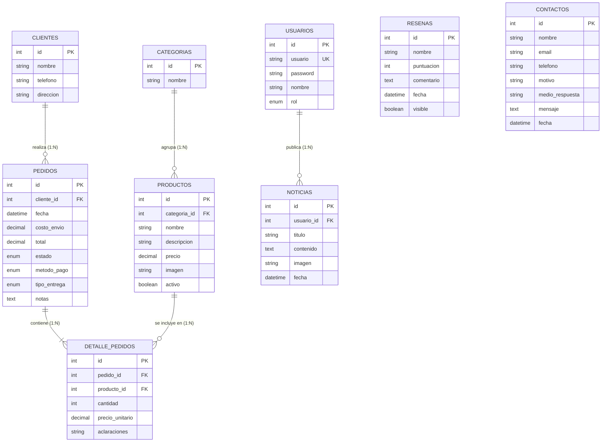

# Sistema de Gestión y Pedidos Online - Restaurante / Pizzería (MVC)

Sistema web integral desarrollado en PHP nativo y MySQL bajo una arquitectura **MVC (Modelo-Vista-Controlador)** para la gestión de catálogo, recepción de pedidos online y administración interna de productos, categorías, noticias, reseñas y mensajes de contacto.

---

## 📋 Características Principales

### Módulo Público (Cliente)
* **Página de Inicio:** Portada con hero, beneficios destacados y llamados a la acción.
* **Catálogo interactivo:** Navegación por categorías con filtros y búsqueda de productos.
* **Carrito de compras:** Gestión de productos en tiempo real mediante `localStorage`.
* **Checkout dinámico:** Elección de tipo de entrega (delivery / retiro en local) y método de pago (efectivo, transferencia, Mercado Pago).
* **Confirmación y Seguimiento:** Página de confirmación con estado del pedido actualizado automáticamente vía AJAX.
* **Novedades y Reseñas:** Sección de noticias y novedades del local junto con un módulo de valoraciones de clientes.
* **Formulario de Contacto:** Registro y almacenamiento seguro de consultas o reclamos en base de datos.

### Módulo Administrativo (Panel de Control)
* **Autenticación segura:** Inicio de sesión mediante manejo de sesiones en PHP y contraseñas encriptadas con `bcrypt`.
* **Control de Pedidos:** Consulta de historial, detalle de ítems y actualización de estados (pendiente, en cocina, enviado, completado, cancelado).
* **Gestión de Productos (CRUD):** Alta, baja lógica, modificación de productos, precios, categorías y carga de imágenes.
* **Gestión de Noticias (CRUD):** Publicación, edición y eliminación de artículos y promociones con imágenes.
* **Moderación de Reseñas:** Aprobación, ocultamiento y eliminación de comentarios de clientes.
* **Mensajes de Contacto:** Lectura y eliminación de consultas recibidas.

---

## 🛠️ Tecnologías Utilizadas

* **Backend:** PHP 8.x (Nativo, arquitectura **MVC** sin frameworks).
* **Base de Datos:** MySQL / MariaDB (Conexiones mediante `PDO` con sentencias preparadas).
* **Frontend:** HTML5, CSS3, JavaScript (ES6+ Vanilla), Bootstrap 5.
* **Persistencia Local:** `localStorage` para el mantenimiento del carrito del lado del cliente.
* **Comunicación Asíncrona:** `fetch` API para el seguimiento del estado de pedidos en tiempo real.

---

## 🏗️ Arquitectura MVC

El proyecto sigue el patrón **Modelo-Vista-Controlador** con un enrutador frontal (*front controller*).

### Flujo de una petición
```
Navegador → public/index.php (Enrutador) → Controlador → Modelo (BD) → Vista → HTML
```

### Componentes
* **Modelos (`app/models/`):** Clases que encapsulan las consultas SQL a la base de datos. Heredan de una clase base `Model` que provee la conexión PDO.
* **Controladores (`app/controllers/`):** Contienen la lógica de negocio. Reciben la petición, consultan a los modelos y renderizan las vistas. Heredan de `Controller` que provee los métodos `render()`, `redirect()` y `json()`.
* **Vistas (`app/views/`):** Archivos PHP que contienen únicamente la presentación (HTML + echo de datos). No realizan consultas a la base de datos.
* **Enrutador (`public/index.php`):** Único punto de entrada. Recibe la variable `url` y deriva la petición al controlador correspondiente.

---

## 📁 Estructura del Proyecto

```text
pizzeria/
│
├── app/
│   ├── controllers/               # Lógica de negocio
│   │   ├── Controller.php         # Clase base (render, redirect, json)
│   │   ├── InicioController.php
│   │   ├── MenuController.php
│   │   ├── CarritoController.php
│   │   ├── PedidoController.php
│   │   ├── ApiController.php
│   │   ├── NosotrosController.php
│   │   ├── ResenasController.php
│   │   ├── ContactoController.php
│   │   ├── AuthController.php
│   │   ├── AdminController.php
│   │   ├── AdminProductosController.php
│   │   ├── AdminNoticiasController.php
│   │   ├── AdminResenasController.php
│   │   └── AdminContactosController.php
│   │
│   ├── models/                    # Acceso a datos
│   │   ├── Model.php              # Clase base (conexión PDO)
│   │   ├── Producto.php
│   │   ├── Categoria.php
│   │   ├── Pedido.php
│   │   └── Usuario.php
│   │
│   └── views/                     # Presentación
│       ├── cliente/
│       │   ├── inicio.php
│       │   ├── menu.php
│       │   ├── carrito.php
│       │   ├── checkout.php
│       │   ├── confirmacion.php
│       │   ├── nosotros.php
│       │   ├── resenas.php
│       │   └── contacto.php
│       └── admin/
│           ├── login.php
│           ├── index.php           # Pedidos
│           ├── productos.php
│           ├── noticias.php
│           ├── resenas.php
│           └── contactos.php
│
├── config/
│   └── conexion.php               # Conexión a BD vía PDO
│
├── includes/
│   ├── header.php                 # Encabezado y barra de navegación
│   ├── footer.php                 # Pie de página común
│   └── funciones.php              # Helpers (e(), formatearPrecio(), etc.)
│
├── public/                        # Directorio público (único accesible por el navegador)
│   ├── index.php                  # Enrutador frontal
│   └── assets/
│       ├── css/
│       │   └── estilos.css
│       ├── js/
│       │   ├── carrito.js
│       │   └── main.js
│       └── img/
│           ├── productos/         # Imágenes subidas de productos
│           ├── noticias/          # Imágenes subidas de noticias
│           └── tocci.png
│
└── base_datos.sql                 # Script de estructura e inserción inicial
```

---

## 🗄️ Base de Datos

El modelo de datos está estructurado para garantizar la integridad referencial y prevenir redundancia.

### Tabla de Entidades
* `clientes`: Datos de los compradores (nombre, teléfono, dirección).
* `pedidos`: Cabecera del pedido (cliente, fecha, total, costo de envío, estado, medio de pago, tipo de entrega).
* `detalle_pedidos`: Desglose de ítems comprados (pedido, producto, cantidad, precio unitario, aclaraciones).
* `productos`: Registro de ítems del catálogo (categoría, nombre, descripción, precio, imagen, estado activo).
* `categorias`: Rubros para organizar el catálogo.
* `usuarios`: Cuentas del personal administrativo.
* `noticias`: Novedades o promociones publicadas por administradores.
* `resenas`: Comentarios y puntuaciones enviadas por los clientes.
* `contactos`: Consultas enviadas desde la sección de contacto.

### Diagrama Entidad-Relación (Mermaid)



---

## 🔗 Rutas del Sistema

Todas las peticiones pasan por el enrutador frontal en `public/index.php` mediante el parámetro `url`.

### Rutas Públicas (Cliente)
| URL | Controlador | Descripción |
|-----|-------------|-------------|
| `index.php?url=inicio` | `InicioController` | Página principal / portada |
| `index.php?url=menu` | `MenuController` | Catálogo de productos |
| `index.php?url=carrito` | `CarritoController` | Vista del carrito de compras |
| `index.php?url=checkout` | `PedidoController` | Formulario de confirmación |
| `index.php?url=procesar` | `PedidoController` | Procesa el pedido (POST) |
| `index.php?url=confirmacion&id=X` | `PedidoController` | Confirmación y seguimiento |
| `index.php?url=api-estado&id=X` | `ApiController` | API JSON del estado (AJAX) |
| `index.php?url=nosotros` | `NosotrosController` | Historia y novedades |
| `index.php?url=resenas` | `ResenasController` | Reseñas públicas y formulario |
| `index.php?url=contacto` | `ContactoController` | Formulario de contacto |

### Rutas de Autenticación
| URL | Controlador | Descripción |
|-----|-------------|-------------|
| `index.php?url=login` | `AuthController` | Inicio de sesión admin |
| `index.php?url=logout` | `AuthController` | Cierre de sesión |

### Rutas del Panel Administrativo
| URL | Controlador | Descripción |
|-----|-------------|-------------|
| `index.php?url=admin` | `AdminController` | Gestión de pedidos |
| `index.php?url=admin-productos` | `AdminProductosController` | CRUD de productos |
| `index.php?url=admin-noticias` | `AdminNoticiasController` | CRUD de noticias |
| `index.php?url=admin-resenas` | `AdminResenasController` | Moderación de reseñas |
| `index.php?url=admin-contactos` | `AdminContactosController` | Mensajes de contacto |

---

## 🚀 Instalación y Configuración Local

### Requisitos Previos
* Servidor web local (XAMPP, WAMP, MAMP o Laragon).
* PHP 8.0 o superior.
* MySQL / MariaDB.
* Módulo `mod_rewrite` de Apache (opcional, solo si se configuran URLs amigables).

### Pasos

1. **Clonar o copiar el proyecto:**
   Colocar la carpeta del proyecto en el directorio del servidor web:
   ```
   C:/xampp/htdocs/pizzeria/
   ```

2. **Importar la Base de Datos:**
   * Iniciar Apache y MySQL en el panel de control (ej. XAMPP).
   * Ingresar a `http://localhost/phpmyadmin`.
   * Crear una nueva base de datos llamada `pizzeria_db`.
   * Seleccionar la base de datos recién creada, ir a la pestaña **Importar** y seleccionar el archivo `base_datos.sql`.

3. **Configurar las credenciales de conexión:**
   Abrir `config/conexion.php` y verificar o modificar los parámetros según la configuración del entorno local:

   ```php
   <?php
   $host = 'localhost';
   $db   = 'pizzeria_db';
   $user = 'root';
   $pass = ''; // Modificar si MySQL requiere contraseña
   $charset = 'utf8mb4';

   $dsn = "mysql:host=$host;dbname=$db;charset=$charset";
   $options = [
       PDO::ATTR_ERRMODE            => PDO::ERRMODE_EXCEPTION,
       PDO::ATTR_DEFAULT_FETCH_MODE => PDO::FETCH_ASSOC,
       PDO::ATTR_EMULATE_PREPARES   => false,
   ];

   try {
       $pdo = new PDO($dsn, $user, $pass, $options);
   } catch (\PDOException $e) {
       exit("Error de conexión a la base de datos: " . $e->getMessage());
   }
   ?>
   ```

4. **Acceso al sistema:**
   * **Sitio Web (Cliente):** `http://localhost/pizzeria/public/index.php?url=inicio`
   * **Panel Administrativo:** `http://localhost/pizzeria/public/index.php?url=login`
     * **Usuario por defecto:** `admin`
     * **Contraseña por defecto:** `admin123`

---

## 🔒 Seguridad Implementada

* **Prevención de Inyección SQL:** Uso estricto de PDO con sentencias preparadas y binding de parámetros en todas las interacciones con la base de datos.
* **Protección contra Cross-Site Scripting (XSS):** Filtrado y sanitizado de datos de entrada/salida mediante la función helper `e()` (que envuelve `htmlspecialchars()`).
* **Autenticación y Hash de Contraseñas:** Encriptación de claves administrativas mediante `password_hash()` con algoritmo `bcrypt` y validación vía `password_verify()`.
* **Protección de Rutas Administrativas:** Verificación de sesión activa mediante la función `estaAutenticado()` antes de acceder a cualquier controlador del panel.
* **Anti-Spam en Formularios:** Campo *honeypot* oculto en los formularios de reseñas y contacto.
* **Post/Redirect/Get (PRG):** Todas las operaciones de escritura (POST) redirigen a una vista GET para evitar reenvíos accidentales al refrescar el navegador.

---

## 📐 Convenciones del Código

* **Nombres de controladores:** `NombreController.php` (PascalCase + sufijo `Controller`).
* **Nombres de modelos:** `Nombre.php` (PascalCase, singular).
* **Nombres de vistas:** `snake_case.php` dentro de `app/views/cliente/` o `app/views/admin/`.
* **Métodos de controladores:** `camelCase` (ej. `estadoPedido`, `cambiarEstado`).
* **Métodos de modelos:** `camelCase` (ej. `obtenerTodosActivos`, `crearPedidoCompleto`).

---

## ✒️ Autor

* **Desarrollador:** Kevin Gamboa
* **Institución:** Instituto Belgrano (Rosario, Santa Fe, Argentina)
* **Carrera:** Tecnicatura Superior en Desarrollo de Software

---

## 📝 Notas Finales

* La carpeta `public/` es la única que debería ser accesible desde el navegador en un entorno de producción.
* Los archivos de `app/`, `config/` e `includes/` deben quedar por fuera del *document root* en producción para mayor seguridad.
* El sistema de seguimiento de pedidos en tiempo real se basa en *polling* cada 3 segundos a la API `index.php?url=api-estado`.
* El carrito de compras del cliente se almacena en `localStorage` bajo la clave `carrito`.